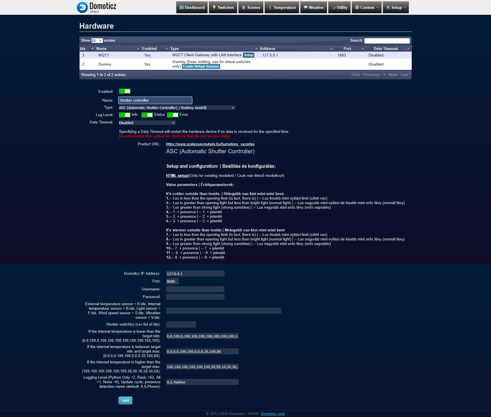
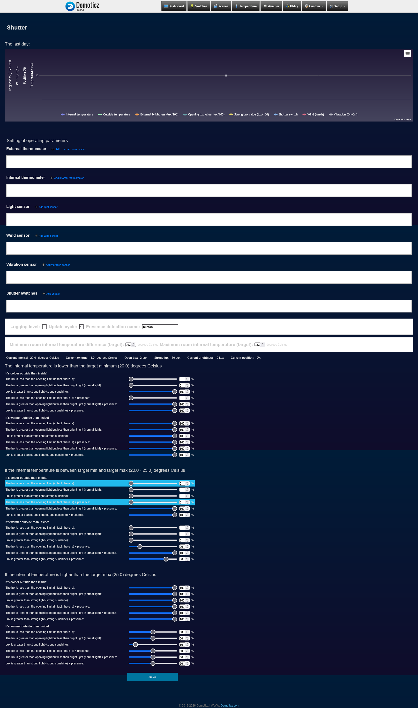
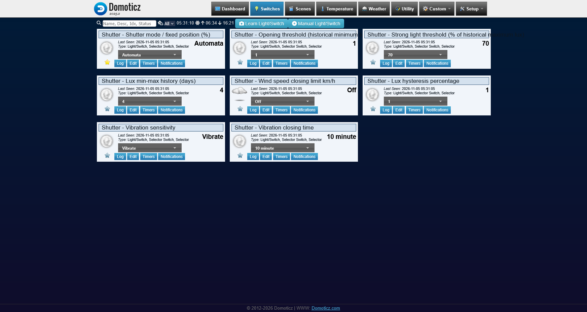

# ASC — Automatic Shutter Controller for Domoticz

**English** | [Magyar leírás](#magyar-leírás)

ASC is a Python plugin for [Domoticz](https://www.domoticz.com/) that controls shutters, roller blinds and other compatible shading devices according to indoor temperature, outdoor conditions, daylight and optional occupancy information. It also provides wind- and vibration-triggered protective actions.

Its primary purpose is to **help keep a room within a user-defined temperature range**, **20–25 °C by default**, using natural light and outdoor temperature to decide when to shade or admit sunlight. For example, when the outdoors is hotter, closing the shutters may limit heat gain; when the outdoors is cooler and strong sunlight could help warm the room, opening them may be beneficial. These are illustrative strategies, **not hard-coded universal rules**: the user assigns a shutter position to each condition.

Optional presence detection can **prioritize occupants' preference for natural light over temperature conservation**. The complete strategy is customizable through ASC's HTML settings page. For rooms or shading areas with different orientations, **separate ASC controller instances** are recommended, potentially with multiple light sensors and different rules for each area.

> [!IMPORTANT]
> **An indoor temperature sensor is optional.** Without one, the current plugin uses a fixed **22 °C** indoor-temperature fallback (see note below); temperature regulation then relies on that assumed value rather than a measurement. This can be useful for terrace shading and other installations without an indoor sensor. An outdoor temperature sensor is also optional because ASC can use forecast data, but a physical sensor is recommended. Presence detection is optional, but strongly recommended to take advantage of the full control matrix. **Vibration protection requires a separate compatible vibration sensor**; it is primarily intended to protect sensitive sun-screen and shading blinds.

## Features

- Temperature-oriented shading to help maintain a configured **20–25 °C default target range**; all operating positions are customizable.
- Comparison of indoor and outdoor temperatures, using a sensor or weather forecast data where available.
- Daylight-dependent operation with configurable opening and strong-light thresholds, lux history and hysteresis.
- Optional presence-aware control that can favor natural daylight and occupant comfort over energy savings.
- **36 configurable operating positions:** three indoor temperature ranges × two indoor/outdoor temperature relationships × three illumination levels × two presence states.
- Manual mode selection and fixed-position control (0%, 5%, 10%, 25%, 50%, 75% and 100%), alongside Off and Automatic modes.
- Wind-speed threshold and optional vibration-triggered protective closing, including a configurable hold period.
- A Domoticz custom HTML configuration page, plus standard Domoticz devices for settings and status.
- Optional hourly forecasts from Open-Meteo for outdoor temperature, wind and estimated illuminance. Forecast-derived lux is an estimate, not a sensor reading.

## Requirements and optional integrations

| Component | Requirement | Notes |
| --- | --- | --- |
| Domoticz with Python plugin support | Required | The plugin has been used with Domoticz 2025.2; support for other releases has not been verified here. |
| Python 3 | Required | Requires Domoticz's working Python plugin system. |
| Indoor temperature sensor | Optional, recommended for room-temperature control | Without one, the current code assumes 22 °C; multiple sensors can be configured. |
| Compatible shutter/blind switches in Domoticz | Required for physical actuation | Configure their Domoticz device IDs (`idx`). |
| Outdoor temperature sensor | Optional, strongly recommended | Forecast temperature can provide a fallback. |
| Lux sensor | Optional, recommended | ASC can estimate illuminance from the weather forecast. |
| Presence detection | Optional, strongly recommended | The current implementation queries OpenWrt/LuCI presence endpoints; these must be available and configured separately. |
| Wind sensor | Optional | Can be replaced by forecast wind data where available. |
| Vibration sensor | Optional, separate hardware required | Especially relevant to sensitive sun-screen blinds. |
| Internet connection | Optional for local sensor-based operation | Required if Open-Meteo forecast data is used. |

### OpenWrt presence detection integration

For presence-aware operation, ASC integrates with the separately installed **[OpenWrt Presence](https://github.com/szelessavalapitvany/openwrt-presence)** module. It supports Wi-Fi and network (ping) presence detection, multiple presence groups and additional OpenWrt access points. **This integration is recommended, not mandatory** for ASC.

Install and configure OpenWrt Presence on the router, create a presence group, then enter its name in ASC's **Mode6** parameter (third comma-separated value) or the custom HTML settings page. ASC queries the router specified by the hardware **Address** setting, using these endpoints:

```text
http://ROUTER-IP/cgi-bin/luci/wifi-presence/GROUPNAME
http://ROUTER-IP/cgi-bin/luci/presence/GROUPNAME
```

These endpoints return `true` or `false`. The **Address** setting is shared by Domoticz API requests and OpenWrt presence requests. For the current integration, the configured host must provide both services (or proxy the necessary endpoints). Consult the [OpenWrt Presence installation and configuration guide](https://github.com/szelessavalapitvany/openwrt-presence#readme) for setup details.

## Installation

1. Copy the plugin into the Domoticz **user-data plugin directory**, in its own folder named `ASC_Shutter_Redony`.
2. Make sure the main script is named `plugin.py`. Place any translation JSON files (`asc_translate_en.json`, `asc_translate_hu.json`) alongside it if supplied with the distribution. For the custom configuration page, install `asc_viewer.js` under the Domoticz web server's `templates/` directory.
3. Restart Domoticz.
4. Open **Setup → Hardware**, select **ASC (Automatic Shutter Controller) / Redőny vezérlő**, configure its parameters and add the hardware instance.
5. After the plugin creates its Domoticz devices, open **Custom → ASC_Shutter_Redony** to assign sensors, shutter switches and operating positions.

Example plugin path on an OpenWrt installation:

```text
/etc/domoticz/plugins/ASC_Shutter_Redony/plugin.py
```

The plugin directory may differ on other systems. Merely copying `plugin.py` does **not** create a hardware instance; you must add it in the Domoticz Hardware page.

### Hardware configuration



The hardware parameters include:

| Parameter | Purpose |
| --- | --- |
| Address / Port | Domoticz API host and port (typically `127.0.0.1` and `8080` when local). |
| Username / Password | Optional Domoticz API credentials, when authentication is enabled. |
| Mode1 | Sensor IDs: `K:idx` outdoor temperature, `B:idx` indoor temperature, `F:idx` lux, `S:idx` wind and `V:idx` vibration. |
| Mode2 | Comma-separated Domoticz shutter switch IDs. |
| Mode3 | Twelve position percentages when the indoor temperature is **below** the minimum target. |
| Mode4 | Twelve position percentages when the indoor temperature is **between** the targets. |
| Mode5 | Twelve position percentages when the indoor temperature is **above** the maximum target. |
| Mode6 | Comma-separated logging level, update interval in minutes, presence group and optional fourth configuration value. |

For convenience, most sensor assignments and percentages can be maintained via the custom HTML page after the hardware instance has been created.

### Custom HTML configuration



The settings page lets you choose optional temperature, light, wind and vibration sensors; assign one or more shutter switches; set the update interval and occupancy group; and adjust the target temperatures and all 36 shading positions. For differently oriented rooms or separate terrace shades, use multiple controller instances with distinct positions and, where appropriate, separate or multiple light sensors.

The position matrix is divided into three indoor temperature ranges. Within each range, ASC distinguishes whether it is colder or warmer outside, three light levels (below opening threshold, intermediate light, strong light), and presence/no-presence conditions. The selected percentage is the commanded shutter position for that combination.

### Domoticz controls



Domoticz exposes operating mode, light thresholds, lux history, wind limit, lux hysteresis, vibration sensitivity and vibration hold time as devices. Use **Automatic** for condition-based control, a fixed percentage for a manual position, or **Off** to disable ASC control. Confirm how your particular shutter actuator interprets percentage values before using it in production.

## Safety and limitations

- When no indoor thermometer is configured, ASC assumes a fixed indoor temperature of **22 °C**, rather than measuring actual room temperature.
- The plugin is an automation controller, **not a certified safety device**. Do not rely on software-only wind or vibration detection as the sole protection for an awning or other hazardous moving structure.
- Vibration detection works only with a separately installed and correctly mapped compatible sensor. The behavior and direction of protective movement must be verified with the actual blind or shutter.
- Presence detection depends on the separately configured presence endpoints; it is not built into Domoticz by default.
- Forecast-based values depend on an external service and can be unavailable or inaccurate. Prefer physical sensors where reliability matters.
- Test sensor assignment, direction of movement, limits and manual override with the motor disconnected or under safe conditions before full operation.

## Project

Developed as part of the **Szélessáv Okos Otthon** open-source smart-home work by **Szélessáv Közhasznú Alapítvány**.

[Project information (Hungarian)](https://www.szelessavmuhely.hu/hu/redony_vezerles)

**Version documented:** 1.3.1 (2026-10-17). License information should be added once a license file has been selected and published.

---

# Magyar leírás

[Back to English](#asc--automatic-shutter-controller-for-domoticz)

Az **ASC (Automatic Shutter Controller)** egy [Domoticz](https://www.domoticz.com/) rendszerhez készült Python plugin, amely a redőnyök, rolók és más kompatibilis árnyékolók működését automatizálja a belső hőmérséklet, a kültéri körülmények, a megvilágítás és – opcionálisan – a jelenlét alapján. Szélsebességre és rezgésre reagáló védelmi funkciókat is tartalmaz.

A vezérlés elsődleges célja, hogy **segítsen a helyiség hőmérsékletét a beállított tartományon belül tartani**, amely alaphelyzetben **20–25 °C**. Figyeli a külső hőmérsékletet és a fényerőt, majd ezekhez igazítja az árnyékolást. Például, ha kint túl meleg van, a redőnyök zárásával csökkenthető a felmelegedés; ha kint hűvösebb van, de erős napsütés segíthet felfűteni a helyiséget, a nyitás lehet kedvezőbb. Ezek **szemléltető példák, nem merev, minden esetben érvényes szabályok**: az egyes állapotokhoz rendelt redőnypozíciók szabadon beállíthatók.

**A jelenlétérzékelés felülírhatja az energiatakarékossági szempontokat**, így a rendszer a bent tartózkodók komfortját és a természetes fényt részesítheti előnyben. A teljes szabályozási stratégia a HTML beállítófelületen személyre szabható. **Eltérő tájolású helyiségekhez vagy teraszárnyékolókhoz célszerű külön ASC vezérlőpéldányt létrehozni**, szükség esetén több fényérzékelővel és az egyes területekhez igazított beállításokkal.

> [!IMPORTANT]
> **A belső hőmérő nem kötelező.** Ha nincs megadva, a jelenlegi plugin **22 °C** állandó belső hőmérséklettel számol (lásd a kódra vonatkozó megjegyzést). Ez például terasz árnyékolásakor is használható, de ilyenkor a helyiség tényleges hőmérsékletét nem méri a rendszer. A külső hőmérő szintén opcionális, mert a rendszer előrejelzési adatot is használhat, de **ajánlott**. A jelenlétérzékelés nem kötelező, viszont a teljes funkcionalitás kihasználásához **erősen ajánlott**. **A vibrációs védelem külön, kompatibilis érzékelőhardvert igényel**; elsősorban a fényvédő rolók és érzékeny árnyékolók védelmére szolgál.

## Fő funkciók

- Hőmérséklet-megőrzést segítő automatikus árnyékolás, alaphelyzetben **20–25 °C-os céltartománnyal** és szabadon beállítható redőnypozíciókkal.
- Külső és belső hőmérséklet összehasonlítása, lehetőség szerint mért adatokkal, szükség esetén előrejelzéssel.
- Luxalapú vezérlés beállítható nyitási és erős fény küszöbbel, előzménykezeléssel és hiszterézissel.
- Opcionális jelenlétfüggő vezérlés, amely az energiatakarékossággal szemben a bent tartózkodók fényigényét és komfortját is előnyben részesítheti.
- **36 konfigurálható redőnypozíció:** három belső hőmérsékleti tartomány × két külső/belső hőmérséklet-viszony × három fényerő-tartomány × két jelenléti állapot.
- Kézi pozícióválasztás (0%, 5%, 10%, 25%, 50%, 75% és 100%), valamint Kikapcsolva és Automata üzemmód.
- Szélsebesség-határérték és opcionális vibráció miatti védelmi zárás, beállítható várakozási idővel.
- Egyedi Domoticz HTML beállítófelület és virtuális eszközök az állapotok és paraméterek kezelésére.
- Opcionális Open-Meteo-előrejelzés külső hőmérséklethez, szélhez és becsült luxértékhez. Az előrejelzett lux nem közvetlen mérési eredmény.

## Szükséges és opcionális elemek

| Összetevő | Szükségesség | Megjegyzés |
| --- | --- | --- |
| Domoticz Python pluginrendszerrel | Kötelező | A plugin Domoticz 2025.2 környezetben használatban volt; más verziók támogatása itt nincs külön igazolva. |
| Python 3 | Kötelező | Működő Domoticz Python pluginrendszer szükséges. |
| Belső hőmérő | Opcionális; helyiséghőmérséklet-szabályozáshoz ajánlott | Enélkül a jelenlegi kód 22 °C-ot feltételez; több érzékelő is megadható. |
| Domoticzban vezérelhető redőny-/rolókapcsoló | A tényleges mozgatáshoz kötelező | A Domoticz-eszközök `idx` azonosítóját kell megadni. |
| Külső hőmérő | Opcionális, erősen ajánlott | Az előrejelzés helyettesítő adatot adhat. |
| Fényérzékelő | Opcionális, ajánlott | A megvilágítás időjárási adatokból is becsülhető. |
| Jelenlétérzékelés | Opcionális, erősen ajánlott | A jelenlegi megoldás külön beállítandó OpenWrt/LuCI jelenlét-API-kat használ. |
| Szélérzékelő | Opcionális | Elérhető előrejelzésből is származhat széladat. |
| Vibrációérzékelő | Opcionális, külön hardver szükséges | Elsősorban érzékeny fényvédő rolókhoz. |
| Internetkapcsolat | Helyi érzékelőkkel nem feltétlenül szükséges | Open-Meteo használatához szükséges. |

### OpenWrt jelenlétérzékelés integrációja

A jelenlétfüggő működéshez az ASC a külön telepíthető **[OpenWrt Presence](https://github.com/szelessavalapitvany/openwrt-presence)** modult használja. Ez Wi-Fi- és hálózati (ping) alapú érzékelést, több jelenlétcsoportot, valamint további OpenWrt hozzáférési pontokat is támogat. **Az integráció erősen ajánlott, de nem kötelező** az ASC használatához.

Telepítsd és állítsd be az OpenWrt Presence modult a routeren, hozz létre egy jelenlétcsoportot, majd add meg a csoport nevét az ASC **Mode6** paraméterében (a harmadik, vesszővel elválasztott érték), vagy a HTML beállítófelületen. Az ASC a hardver **Address** mezőjében megadott címen az alábbi végpontokat kérdezi le:

```text
http://ROUTER-IP/cgi-bin/luci/wifi-presence/CSOPORTNEV
http://ROUTER-IP/cgi-bin/luci/presence/CSOPORTNEV
```

A végpontok `true` vagy `false` választ adnak. Az **Address** mezőt a Domoticz API és a jelenlét-API is használja, ezért a jelenlegi megoldásban a beállított címen mindkét szolgáltatásnak elérhetőnek kell lennie (vagy megfelelő továbbítást kell beállítani). A részletes telepítési és beállítási tudnivalók az [OpenWrt Presence projekt README-jében](https://github.com/szelessavalapitvany/openwrt-presence#readme) találhatók.

## Telepítés

1. Másold a plugint a Domoticz **felhasználói adatkönyvtárának `plugins` mappájába**, az `ASC_Shutter_Redony` alkönyvtárba.
2. A fő fájl neve `plugin.py` legyen. Ha a kiadáshoz tartoznak `asc_translate_en.json` és `asc_translate_hu.json` nyelvi fájlok, azok is a plugin könyvtárába kerüljenek. Az egyedi beállítóoldal `asc_viewer.js` fájlját a Domoticz webszerverének `templates/` könyvtárában kell elhelyezni.
3. Indítsd újra a Domoticzot.
4. A **Beállítások → Hardver** oldalon válaszd az **ASC (Automatic Shutter Controller) / Redőny vezérlő** típust, add meg a paramétereket, majd hozd létre a hardvert.
5. A szükséges virtuális eszközök létrehozása után a **Custom → ASC_Shutter_Redony** felületen állíthatók be az érzékelők, redőnyök és működési pozíciók.

Példa OpenWrt alatti útvonalra:

```text
/etc/domoticz/plugins/ASC_Shutter_Redony/plugin.py
```

Más rendszeren az útvonal eltérhet. **A fájl bemásolása önmagában nem hoz létre hardvert:** azt a Domoticz Hardver oldalán külön fel kell venni.

### Hardver hozzáadása


A hardver paraméterei:

| Paraméter | Funkció |
| --- | --- |
| Address / Port | Domoticz API címe és portja (helyi telepítésnél jellemzően `127.0.0.1` és `8080`). |
| Username / Password | Opcionális API-hitelesítés, ha szükséges. |
| Mode1 | Érzékelők `idx` értékei: `K:idx` külső hőmérő, `B:idx` belső hőmérő, `F:idx` fényérzékelő, `S:idx` szélmérő, `V:idx` vibrációérzékelő. |
| Mode2 | A vezérelt redőnykapcsolók vesszővel elválasztott Domoticz `idx` értékei. |
| Mode3 | Tizenkét százalékos pozíció, amikor a belső hőmérséklet a **minimum célérték alatt** van. |
| Mode4 | Tizenkét százalékos pozíció, amikor a belső hőmérséklet a **két célérték között** van. |
| Mode5 | Tizenkét százalékos pozíció, amikor a belső hőmérséklet a **maximum célérték felett** van. |
| Mode6 | Naplózási szint, frissítési idő percben, jelenlétcsoport és opcionális negyedik konfigurációs érték. |

A létrehozott hardver érzékelői és a pozíciók nagy része kényelmesebben kezelhető az egyedi HTML felületen.

### HTML beállítófelület


A felületen kiválaszthatók az opcionális belső/külső hőmérők, fény-, szél- és vibrációérzékelők, a vezérelt redőnyök, a frissítési idő, a jelenlétcsoport, a célhőmérsékletek és a **36 egyedi redőnypozíció**. Eltérő tájolású helyiségek vagy teraszok esetén több vezérlőpéldány használható külön szabályozással és akár eltérő, több fényérzékelővel.

A működési mátrix három belső hőmérsékleti tartományra oszlik. Mindegyiknél külön kezelhető, hogy kint hidegebb vagy melegebb van-e, milyen a fényerő (sötét, normál fény, erős napsütés), valamint érzékelhető-e jelenlét. Az adott kombinációhoz beállított százalék lesz a kért redőnypozíció.

### Domoticz kapcsolók és szabályozók


A Domoticzban külön eszközön állítható többek között az üzemmód, a luxküszöb, a luxelőzmény napjainak száma, a szélhatár, a luxhiszterézis, a vibrációérzékenység és a vibráció miatti zárva tartás ideje. **Automata** módban a környezeti szabályok érvényesek; a százalékos üzemmódok kézi pozíciót adnak; **Off** esetén az ASC vezérlés ki van kapcsolva. Használat előtt ellenőrizni kell, hogy az adott redőnymotor hogyan értelmezi a százalékos állásokat.

## Biztonság és korlátok

- Belső hőmérő hiányában az ASC **22 °C** állandó belső hőmérséklettel számol a tényleges hőmérséklet mérése helyett.
- Az ASC automatizálási eszköz, **nem minősített biztonsági rendszer**. Napellenző vagy más veszélyes mozgású szerkezet esetén a szél- és vibrációvédelem nem lehet az egyetlen biztonsági megoldás.
- A vibrációs védelem csak megfelelően telepített és beállított külön érzékelővel működik. A védelmi mozgás irányát és hatását az adott árnyékolón ellenőrizni kell.
- A jelenlétérzékelés külön konfigurált jelenlét-API-kra épül; azok nem a Domoticz alapfunkciói.
- Az előrejelzés külső szolgáltatástól függ, és pontatlan vagy átmenetileg elérhetetlen lehet. Ahol fontos a megbízhatóság, érdemes fizikai érzékelőt használni.
- Éles használat előtt biztonságos körülmények között ellenőrizd a szenzorokat, a mozgatási irányt, a végállásokat és a kézi felülbírálást.

## A projektről

A plugin a **Szélessáv Közhasznú Alapítvány** **Szélessáv Okos Otthon** nyílt forráskódú fejlesztéseinek része.

[Projektoldal és további információk](https://www.szelessavmuhely.hu/hu/redony_vezerles)

**Dokumentált verzió:** 1.3.1 (2026-10-17). A licencet a kiválasztott és közzétett `LICENSE` fájl alapján kell feltüntetni.
